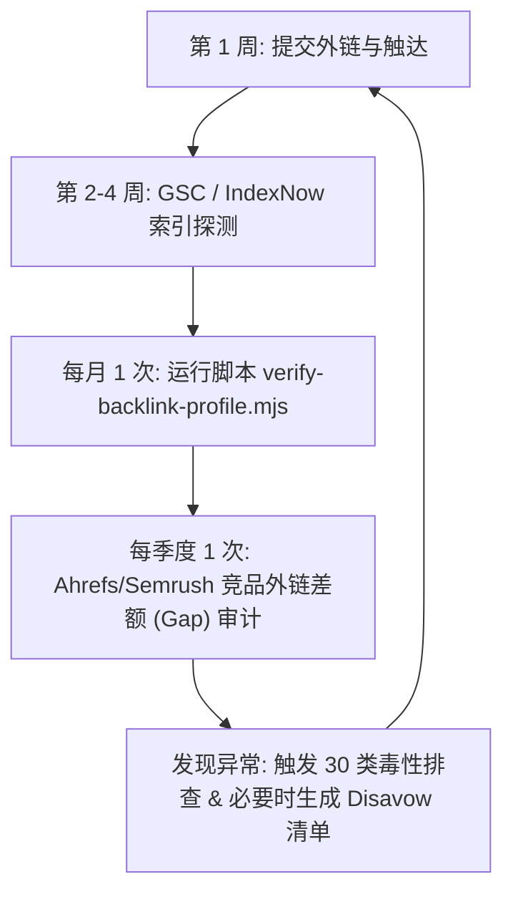

# volvet B2B 工业独立站全维度外链战略矩阵与执行 SOP

本矩阵结合 Google 官方搜索质量指南（Search Quality Rater Guidelines）、`seo-backlinks` 技能规范及视频教程核心逻辑，为 **volvet**（`https://www.velolev.org`）便携式液压立杆机定制全套可执行的外链建设标准与风控体系。

---

## 一、 战略总览与外链三层金字塔模型

在 B2B 重型施工与市政机电设备领域，外链的核心本质是**“工程信任投票”**（Trust Signals）。盲目的低质量数量堆叠无法推动高客单价机械的海外询盘与排名，必须按照金字塔层级建立差异化权重网络。

```text
                  ▲
                 / \
                /   \     Tier 1: 核心权威与行业背书 (DA 70–98)
               / Tier1\    - 官方开源工程库 (GitHub DA 98)
              /---------\   - 国际照明与电气标准协会 (IES, IEEE, CIBSE)
             /           \  - 权威工业与工程媒体深度报道 (GlobalSpec, Construction Europe)
            /   Tier 2    \ 
           /---------------\ Tier 2: 垂直流量与行业口碑 (DA 40–70)
          /                 \ - 太阳能/路灯施工与土木工程博客客座投稿 (Guest Posting)
         /      Tier 3       \- 专业问答与论坛深度讨论 (Reddit r/electricians, Quora)
        /---------------------\- 全球核心工业制造黄页 (ThomasNet, Europages, Kompass)
       /                       \ 
                                 Tier 3: 基础数字足迹与品牌实体标记 (DA 30–80)
                                 - 官方社媒网络 (LinkedIn Company, YouTube, X, Crunchbase)
                                 - 行业白皮书与选型表 PDF 存档 (ResearchGate, SlideShare)
                                 - 开源工具包与数据引用 (Zenodo DOI, npm, jsDelivr)
```

---

## 二、 锚文本（Anchor Text）黄金配比与防操纵红线

为防范 Google SpamBrain 与企鹅算法（Penguin）对过度优化（Over-optimization）的惩罚，volvet 全站外链必须严格执行以下分布配比：

| 锚文本类型 | 严格控制占比 | 代表性锚文本示例 | 战略目的与风控红线 |
| :--- | :---: | :--- | :--- |
| **品牌锚文本 (Branded)** | **45% – 50%** | `volvet`, `volvet engineering`, `volvet lifter`, `equipos volvet` | 巩固“volvet = 便携立杆机唯一品牌”的知识图谱认知，最安全、权重最高。 |
| **裸链/URL (Naked URL)** | **20% – 25%** | `https://www.velolev.org/`, `velolev.org`, `www.velolev.org/tools/roi-calculator/` | 模拟行业白皮书、学术报告与论坛参考文献的自然引用习惯。 |
| **通用锚文本 (Generic)** | **10% – 15%** | `visit website`, `source`, `view full specifications`, `online calculator`, `leer más` | 自然链接的必备佐证，有效稀释关键词浓度，避免被判定操纵排名。 |
| **部分匹配词 (Partial Match)** | **10% – 15%** | `portable pole lifter by volvet`, `volvet 12m light pole installation method`, `crane cost comparison tool` | 将品牌名与核心品类/长尾场景组合，兼顾主题相关性与自然度。 |
| **精准关键词 (Exact Match)** | **3% – 5%** | `portable light pole lifter`, `light pole jack`, `install light poles without crane` | **风控红线**：严禁超过 5%。一旦单月 Exact Match 占比超过 15%，将直接触发 Google 算法降权。 |

### Dofollow 与 Nofollow 属性平衡
- **目标配比**：`Dofollow 60%–70%` : `Nofollow / UGC / Sponsored 30%–40%`。
- **原则**：100% 全为 Dofollow 属于明显的人工作弊特征；知名社区（Reddit/Quora/论坛）与社媒的 Nofollow 外链虽不直接传递 PageRank，但能带来真实采购商引流、提升域名自然度，并协助 Google 爬虫发现新页面。

---

## 三、 四大“可链接资产”（Linkable Assets）矩阵与落地页映射

外部博主与站长只愿意链接有实际参考价值的内容。volvet 依托已发布的数字化功能，包装出 4 个极具传播力度的外链磁铁：

| 资产名称 | 目标落地 URL | 核心受众与应用场景 | 价值钩子（Why Others Link to Us） |
| :--- | :--- | :--- | :--- |
| **1. 起重机 vs 便携机项目成本测算器** | `https://www.velolev.org/tools/roi-calculator/` | EPC 造价师、施工承包商、太阳能工程预算人员 | **行业首创开放数学模型**：无需注册、无预设单价偏见，用户可自填当地工时、台班费测算真实年度盈亏平衡点。 |
| **2. 灯杆法兰孔距与地脚螺栓兼容性校核器** | `https://www.velolev.org/guides/pole-jack-compatibility/` | 市政电气监理、路灯设计院、现场安装工程师 | **现场工程避坑指南**：即时校核 M16–M24 螺栓与 180–260mm 孔中心距，明确非标法兰与 6/8 孔的工程边界。 |
| **3. 官方开源工程规格与判定库 (GitHub DA 98)** | `https://github.com/kaosmys129/portable-pole-lifter-specifications` | 机械集成商、机电软硬件工程师、行业研究者 | **公信力开源信源**：提供规范的 JSON/CSV 参数总表、Schema 及零依赖判定代码，支持学术与工程正规引用。 |
| **4. 无起重机 12 米路灯安装全流程技术指南** | `https://www.velolev.org/guides/install-light-pole-without-crane/` | 基础设施维保队、安全施工培训机构、行业媒体 | **详尽的现场 SOP 替代方案**：涵盖进场搬运、底座生根、20秒起升行程、8.0 m/s 风力停工红线与地基反力分析。 |

---

## 四、 视频教程八大外链获取渠道的执行 SOP

### 渠道 1：客座博客投稿（Guest Posting）
- **适用层级**：Tier 2 垂直高质量外链。
- **执行流程**：
  1. 寻找电气施工、市政工程、太阳能照明行业独立博客（在 Google 搜索 `inurl:write-for-us "electrical contractor"` 或 `inurl:guest-post "solar lighting"`）；
  2. 提交具备工程深度的干货提案（例如：《5 Cost Traps in Municipal Street Light Pole Installation & How Modular Hydraulics Solves Them》）；
  3. 在文章正文第 3 段以后自然植入 1 处针对 ROI 测算器或技术白皮书的参考引用；
  4. 绝不在作者简介（Author Bio）中堆砌商业交易词。

### 渠道 2：行业资源页收录（Resource Pages）
- **适用层级**：Tier 1 & Tier 2。
- **执行流程**：
  1. 检索大学土木工程系、市政电气协会或专业施工工具汇总页面（Google 搜索 `"useful resources" + "street lighting" OR "civil engineering tools"`）；
  2. 发送工具推荐邮件，强调 volvet ROI 计算器与法兰校核器的纯粹工程实用性与免登录特性；
  3. 建议对方将其补充至“Free Calculators & Sizing Tools”子分类中。

### 渠道 3：数据驱动公关（Data-driven PR）
- **适用层级**：Tier 1 权威媒体与行业新闻。
- **执行流程**：
  1. 基于全球路灯安装工况数据，提炼《2026 Global Light Pole Erection Efficiency & Safety Benchmark》（2026全球路灯立杆施工效率与安全基准数据简报）；
  2. 向机械工程与基础设施媒体（如 Construction Europe, Lighting Today, B2B Engineering News）提供独家统计摘要；
  3. 引导媒体在引用数据时将来源标注为 `According to research by volvet Engineering (velolev.org)...`。

### 渠道 4：专家媒体引用与记者问答（Digital PR）
- **适用层级**：Tier 1 高权威新闻引用。
- **执行流程**：
  1. 注册 Connectively (原 HARO)、Featured.com、Qwoted 等记者信源对接平台；
  2. 订阅分类：`Construction & Real Estate`, `Energy & Utilities`, `Business & Technology`；
  3. 针对记者关于“施工降本”、“狭窄空间设备替代”、“市政绿色施工”的提问，以主任工程师视角提供专业答复，附带官方学术主页链接。

### 渠道 5：专业论坛与工程师社区（Forums & Q&A）
- **适用层级**：Tier 2 真实流量与 UGC 链接。
- **执行流程**：
  1. 重点布局平台：Reddit (`r/electricians`, `r/CivilEngineering`, `r/SolarDIY`)、Quora、Mike Holt's Electrical Forum 等；
  2. 严禁发送直白广告。必须针对用户提问（如“吊车无法进入的狭窄非机动车道或坡地如何立 10-12m 太阳能路灯？”）提供真实工序方案与受力分析；
  3. 作为延伸阅读，附上 GitHub 规格库或官网法兰判定链接，获得真实同行点击。

### 渠道 6：垂直 B2B 工业名录（Industrial Directories）
- **适用层级**：Tier 2 权威实体黄页。
- **执行流程**：
  1. 完成全球 Top 20 工业与装备制造名录的入驻（ThomasNet, Kompass, Europages, IndustryNet, GlobalSpec, DirectIndustry）；
  2. 严格统一全网 NAP（Name: volvet, Address: 官方生产研发基地, Phone/Contact: 统一官方通道）；
  3. 在产品分类中准确勾选 `Street Lighting Installation Equipment`, `Hydraulic Pole Erectors`, `Solar Light Installation Tools`。

### 渠道 7：技术内容营销与学术传播（Content Syndication）
- **适用层级**：Tier 3 权威数字足迹。
- **执行流程**：
  1. 将 30 天多语言博客中的核心深度技术文章提炼为 SlideShare 演示课件与 ResearchGate 白皮书；
  2. 将 GitHub 开源仓库同步至 Zenodo 获取学术 DOI 终身数字标识符；
  3. 在领英官方主页（LinkedIn Company Page）定期发布工程实测数据长文。

### 渠道 8：竞品外链反向工程与死链替换（Competitor Gap & Broken Link Building）
- **适用层级**：Tier 2 高相关性替换外链。
- **执行流程**：
  1. 使用 Ahrefs / Semrush 监控国内外已停更的吊车租赁网站、传统拔杆机（Pole Puller）厂商的外部反向链接；
  2. 筛选出 HTTP 404 或内容陈旧过时的引用页面；
  3. 礼貌致信站长，指出其文章中存在失效链接，并推荐 volvet 最新的在线替代方法指南或 ROI 计算器作为更新候选。

---

## 五、 垃圾外链 30 种特征排查与 Google Disavow 申诉处置标准

严格遵循 `seo-backlinks` 规范，定期审查全站外链，识别并清除以下 30 类潜在风险链接：

### 1. 绝对垃圾（Auto-Flag，需立即处置）
1. 来自单页导出链接超过 10,000 个的“外链农场（Link Farm）”；
2. 来源域名在 Google 搜索中已被彻底清退（0 收录）；
3. 域名注册不足 30 天但瞬间产生 100+ 导出链接的突击站；
4. 超过 5 个毫无关联的垃圾网站使用 100% 精确商业词链接；
5. 门面页面（Doorway Pages，关键词堆砌的薄内容站）；
6. 遭遇黑客篡改（含博彩、色情、医药注入）的受感染站点；
7. 来自已知私人博客网络（PBN）的批量模板站；
8. 全站页脚（Footer）或侧边栏（Sidebar）硬植入的泛目录站点；
9. AI 机械伪原创或同义词乱换的自动生成垃圾文章；
10. 已遭受 Google 人工处置（Manual Action）的受罚域名。

### 2. 疑似垃圾（Manual Review，需人工研判）
11. 来源站点全站导出链接比例超过 90%；
12. 语言与受众完全不相符（如俄语博彩站链接到英语电气设备）；
13. 购买已被拍卖的老域名改造成的泛垂直内容站；
14. 单页导出链接超过 50 个的低质博客页面；
15. 毫无真实自然访问量的停放域名（Parked Domains）；
16. 跨 10 个以上域名的大规模交叉互链（Reciprocal Links）；
17. 内容极度单薄（<100 词）的免费博客平台（Web 2.0）；
18. 劣质文章目录站（EzineArticles 等）；
19. 付费外链交易平台的标准化外链包；
20. 行业风马牛不相及（如宠物日用品博客链接到工程液压立杆机）。

### 3. 潜在风险（Monitor，密切观察）
21. 批量书签聚合网站（Social Bookmarks）；
22. 仅在论坛个人资料签名（Profile Signature）中存在链接，无正文讨论；
23. 泛滥的新闻通稿群发渠道（Press Release Networks）；
24. 优惠券/打折信息聚合站；
25. 缺乏行业分类的泛目录黄页；
26. 带有隐藏样式（CSS `display:none` 或字体极小透明）的暗链；
27. 采用 Cloaking（面对爬虫和用户展示两套不同内容）的站点；
28. 纯 Affiliate 佣金导流且无实质测评的页面；
29. 博客评论区被群发软件批量留下的评论外链；
30. 100% 来源全部为无价值的纯 Nofollow 垃圾采集器。

### Google Disavow（外链拒绝）标准执行规则
- **何种情况提交 Disavow**：
  1. GSC 收到 Google 发送的“非自然外链”（Unnatural Links）人工处置警告；
  2. 遭受恶意负面 SEO 攻击（短时间内突然暴涨数千条成人/赌博外链）；
  3. 明确识别的高毒性外链比例超过全站外链的 10%。
- **何种情况无需 Disavow**：
  - 零散的低质蜘蛛采集站（Google 现代算法已能自动忽略此类噪点，盲目拒绝可能误伤有效链接）；
  - 正常的 Nofollow 外链（不传递权重，不会引发惩罚）。

---

## 六、 持续监控与工具闭环（Monitoring Cycle）



1. **Google Search Console“链接”控制台**：
   - 每两周导出一次“顶级指向网站”与“顶级链接网页”，核验新增来源域名的合法性与目标落地页承接能力。
2. **Google Alerts 品牌声量监控**：
   - 配置关键词监控：`"volvet"`, `"velolev.org"`, `"portable light pole lifter"`，一旦发现未加外链的媒体报道或论坛提及（Unlinked Brand Mentions），第一时间执行联系要求补充来源出处链接。
3. **自动化测试守门**：
   - 将外链分布与目标目录纳入工程端日常自动化审计，持续保障外链健康生态。
