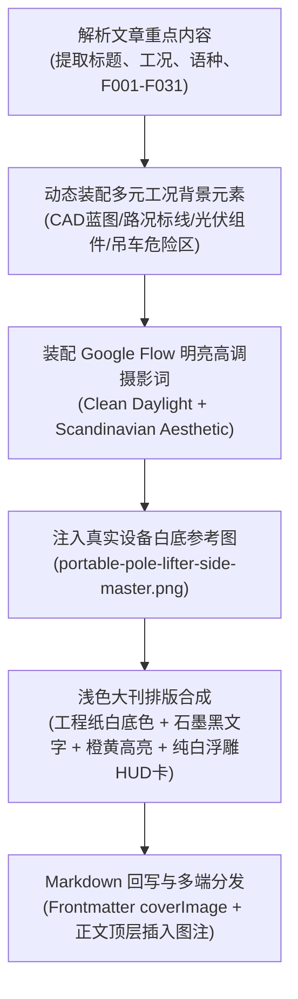

# GEOFlow 文章配图与工商业视觉卡片生成技能 (GEOFlow Article Illustration Skill)

> **视觉风格公告**：本技能生成的全套视觉资产全面对齐出海独立站主站的 **高定浅色系（Nordic Light Industrial Palette）**：底色采用温暖典雅的工程纸白（`--paper: #f3f2ec` / `#fbfbf9`），主体文字采用深石墨黑（`--ink: #1d201e`），关键词高亮采用工业安全橙（`#ea580c`）与品牌黄（`#f4cc3d`），边框采用极细浅灰工程刻度（`--line: #d5d8cd`）。**彻底告别死板的深色暗夜 PPT 质感，与整站浅色风格 100% 完美交融！**

本技能专为 **GEOFlow 出海独立站长文与 GEO 营销内容** 打造，深度融合 **Google Flow MCP 电影级明亮晨光写实摄影**、**多元工程现场实况与 CAD 蓝图背景**、**瑞士国际主义工商业卡片排版规范** 与 **企业级原子物理事实治理网 (F001–F031)**，为便携式路灯立杆机（volvet / portable light pole lifter）等重工装备文章输出高保真、多比例、全语种（en/es/fr/pt/vi/th/id + zh）的顶级商业交付视觉。

---

## 一、 核心功能与输出卡片清单

运行本技能可为任意一篇 Markdown 文章一键输出以下 **8 张** 核心视觉交付资产（保存在 `geo-drafts/articles/images/<slug>/` 目录并同步分发至 `maquin-astro-theme/public/images/<slug>/`）：

0. **`cover-flow-hero-16x9.png` (1920 × 1080 · 16:9 · 高定浅色系工程封面大图 · 强烈点击欲望)**：
   * **视觉调性**：整站浅色工业调性（温暖工程纸白底色 + CAD 坐标细网格 + 真实重机立姿 + 浮雕纯白卡片）；
   * **多元背景元素（根据文章核心论点动态匹配，不限于地图）**：
     - *高速公路与成本对比*：双向多车道高速标线、道路黄色虚线、远景 16t 汽车起重机 15m 封路危险区虚线对比 vs 近景便携式 2.5m 免占道作业区；
     - *市政狭窄人行道与绿化带*：透水砖纹理铺装、路缘石、沿街预埋灯杆点位、双人搬运 1.2m 狭小空间准入通道；
     - *太阳能智慧离网照明*：单晶硅光伏组件（PV Panel）几何剖面、24V 动力储能箱能量流、分布式灯位矩阵点；
     - *地基法兰与土建力学*：混凝土短柱基座 CAD 剖面、M16-M24 地脚锚栓分布、P.C.D. 180-260mm 径向腰孔力学同心圆；
   * **主体立姿**：volvet 真实便携式立杆机高精度透明立姿（橙灰工业配色），配合地面柔和自然漫射阴影与 0°-45° 激光起升动态圆弧；
   * **用途**：文章 Frontmatter `coverImage`、独立站 Blog 头部 Banner、Google Discover 推荐大图、社交媒体分享大卡。

1. **`01-feature-hero-cover-16x9.png` (1920 × 1080 · 16:9 · 瑞士工商业全景工程卡)**：
   * **用途**：篇首 Key Takeaways 前后的工程全景总览图、OpenGraph `og:image`；
   * **要素**：volvet 官方品牌徽标、工程主标题、4 栏核心 KPI 塔（300kg 垂直载荷、12m 杆高、85kg 双模组分体、24V DC 电池）、真实主机透明立姿抠图、OSHA/IEEE/EN 权威标准引证。

2. **`02-two-module-architecture-16x9.png` (1920 × 1080 · 16:9 · 机械工程架构分解图)**：
   * **用途**：篇内 Section 1 机械工程架构配图；
   * **要素**：双模组分体设计拆解（45kg 液压主机模组 + 40kg 24V DC 电气控制箱）、800mm 行程液压缸、二级高强合金安全机械防坠锁销、两名作业人员标准皮卡搬运合规标注。

3. **`03-flange-pcd-compatibility-16x9.png` (1920 × 1080 · 16:9 · 地基与法兰适配工程图)**：
   * **用途**：篇内 Section 3 地基与法兰适配配图；
   * **要素**：通用底板径向长腰孔几何图示、P.C.D. 180mm 至 260mm 范围标定、M16/M18/M20/M22 标配紧固套件、M24 螺栓图纸核验说明、ASTM F1554 抗剪受拉力学说明。

4. **`04-sop-field-workflow-16x9.png` (1920 × 1080 · 16:9 · 三阶段双人标准化作业流程图)**：
   * **用途**：篇内 Section 4 标准施工工序配图；
   * **要素**：三阶段地面预装与电控平稳起升工序（勘测排查 $\rightarrow$ 自锚卡装 $\rightarrow$ 24V 顶升锁固）、严格双人编制警示（一人液压遥控，一人 45° 观察对孔）、OSHA 1926 与 IEEE 516 临电安全缓冲区防范。

5. **`05-crane-vs-lifter-comparison-16x9.png` (1920 × 1080 · 16:9 · 吊车 vs 立杆机对比决策矩阵)**：
   * **用途**：篇内 Section 5 或 ROI 测算段落对比决策图；
   * **要素**：16 吨随车吊/起重机与便携式立杆机全景对比矩阵（进场路宽、临电触电风险、调机与路权审批、人员编制、单杆作业耗时 15-20 分钟 vs 1.5-3 小时）。

6. **`social-3x4-01-cover.png` (1080 × 1440 · 3:4 · 竖版移动端轮播卡)**：
   * **用途**：海外移动端阅读、LinkedIn 轮播文档（Carousels）、小红书出海笔记长图；
   * **要素**：垂直高密度构图、醒目陈述标题、真实硬件产品图、核心技术参数胶囊标签。

7. **`square-1x1-thumb.png` (1080 × 1080 · 1:1 · 正方形缩略图)**：
   * **用途**：独立站列表缩略图、微信公众号方封面、社媒方形头像卡。

---

## 二、 自动化执行工作流 (Command Line Usage)

在项目根目录下，支持单篇执行与全量批量执行：

```bash
# 1. 为指定单篇文章生成浅色系高定封面大图并自动回写 Markdown
npm run visuals:cover -- --article geo-drafts/articles/portable-light-pole-lifter-explainer-en.md --insert-markdown

# 2. 全量批量生成所有出海文章的浅色系封面大图并回写
npm run visuals:cover:all

# 3. 仅导出 Google Flow MCP 请求契约与明亮晨光工业级提示词（供 AI Agent 检查）
npm run visuals:cover -- --article geo-drafts/articles/portable-light-pole-lifter-explainer-en.md --dry-run

# 4. 一键执行全套瑞士工商业 7 卡位图渲染与正文挂载
npm run visuals:generate -- --article geo-drafts/articles/portable-light-pole-lifter-explainer-en.md --insert-markdown

# 5. 全量多语言矩阵流水线（生成草稿 + 浅色封面图 + 7 卡位图 + 门禁校验 + 自动入库）
node geoflow-b2b-seo-blog-pipeline/scripts/matrix_content_pipeline.mjs --topic portable-light-pole-lifter-explainer
```

---

## 三、 高定浅色系封面大图生成 SOP (Nordic Light Industrial SOP)



### 1. 多元工况背景元素矩阵（不仅限于地图）
根据文章类型与核心关键词自动判定工况类别，动态渲染对应的高精度浅色工程背景：

| 工况类别 (`contextType`) | 匹配文章特征词 | 专属背景元素组合 |
|---|---|---|
| **高速公路与对比 (`HIGHWAY`)** | `highway`, `crane vs`, `随车吊`, `cost`, `roi` | 6 车道双向高速公路标线、黄色车道虚线、16t 随车吊 15m 危险禁入虚线区（对比突出痛点）、便携立杆机 2.5m 紧凑绿色通行区、里程桩牌 |
| **城市狭窄人行道 (`URBAN`)** | `sidewalk`, `narrow`, `人行道`, `绿化带`, `urban` | 透水砖纹理人行道几何标线、路缘石、沿街树穴绿化带、路灯预埋点位（`LP-01 ~ LP-08`）、1.2m 双人通行准入通道标定 |
| **太阳能离网照明 (`SOLAR`)** | `solar`, `battery`, `太阳能`, `off-grid`, `pv` | 太阳能单晶硅光伏组件（PV Module）CAD 剖面、24V DC 动力总成回路与 50+ 次循环动能参数、分布式路灯节点阵列 |
| **地基与法兰适配 (`FLANGE`)** | `flange`, `pcd`, `mặt bích`, `foundation`, `法兰` | 混凝土短柱基座（600×600mm）CAD 轴线、P.C.D. 180-260mm 径向长腰孔双同心圆标定、M16-M24 地脚螺栓 4 向受力矢量 |

### 2. Google Flow MCP 提示词浅色高调规范 (High-Key Prompt)
明确指定明亮高调的清晨自然光工业摄影，杜绝阴暗压抑的黑夜画面：

```text
Cinematic, bright daylight, Scandinavian architectural documentary engineering photography of the volvet portable light pole lifter rig operating on site.
Subject: A heavy-duty, compact industrial fluid-power pole lifter machine with a telescoping hydraulic lift column (finished in industrial safety orange and graphite grey), firmly bolted to a concrete foundation base with heavy galvanized anchor bolts. A secondary mechanical safety lock pin is clearly visible on the hydraulic mast.
Action & Crew: Two professional utility electricians wearing clean fluorescent high-visibility safety vests (EN ISO 20471 compliant) and hard hats are working collaboratively. One technician operates the handheld ergonomic remote control pendant, while the second technician observes at a 45-degree vantage angle to ensure clearance. A standard 10-meter octagonal galvanized steel street lighting pole is tilting steadily upward from 0 to 45 degrees towards the vertical position.
Setting & Environment: [DYNAMIC_SPECIFIC_CONTEXT]. Bright morning natural sunlight, clear blue sky, clean pale concrete pavement and curb alignment. Clean site logistics. Noticeably NO large mobile cranes, NO 16-ton boom trucks, NO extended outriggers blocking traffic, leaving the street lane completely open and unobstructed.
Style & Lighting: Clean Scandinavian light industrial aesthetic, high-key photography, shot on Hasselblad H6D-100c medium format camera with 50mm f/4 prime lens. Warm morning daylight casting soft, realistic shadows on light-toned pavement. Crisp engineering details, authentic mechanical textures, shallow depth of field, 8K resolution, ultra-detailed, photorealistic editorial style, award-winning industrial design showcase, zero AI cartoonish artifacts, no dark gritty shadows, no text watermark.
```

### 3. 浅色系排版与色彩铁律 (Nordic Light Palette)
1. **背景底色**：
   采用工程暖白（`#fcfcfb` 至 `#f5f6f2`），叠加 48×48px 极细坐标微网格（`rgba(29, 32, 30, 0.04)`）；
2. **文字层级**：
   * 主标题采用深石墨黑（`#1d201e`），字重 900；
   * 核心关键词（如 *Zero-Crane*、*零吊车*、*Sin Grúa*）采用**工业安全橙（`#ea580c`）**高亮，下衬品牌黄底线（`#f4cc3d`）；
   * 副标题与说明采用优雅冷灰（`#4b5563`）；
3. **HUD 遥测卡片**：
   采用纯白浮雕卡片（`background: #ffffff; border: 1px solid #d5d8cd; box-shadow: 0 10px 25px rgba(29, 32, 30, 0.06); border-left: 4px solid #ea580c;`），展示 300KG 垂直试验台核定、12M 杆高、85KG 双模组分体；
4. **事实网原子基准硬锁定**：
   * 严守 300kg 垂直试验台核定载荷（F002）；
   * 严守 12m 最大杆高（F003）；
   * 严守 85kg 双模组分体总重（F008）；
   * 严守双人作业编制（two-person crew），严禁承诺单人作业；
   * 严禁出现未经证实的虚构认证与裸露货币符号。

---

## 四、 自动化复核与验证命令

生成完成后，依次执行合规门禁、事实台账提取与 GEOFlow 后台同步：

```bash
# 1. 验证封面图与配图文件完整性
ls -lh geo-drafts/articles/images/portable-light-pole-lifter-explainer-en/

# 2. 合规红线自动化复核 (认证、货币、品牌名、人员编制、物理参数)
node geoflow-b2b-seo-blog-pipeline/scripts/verify_compliance_guardrails.mjs \
  geo-drafts/articles/portable-light-pole-lifter-explainer-en.md

# 3. 一键同步至 GEOFlow 后台待审列表
node geoflow-b2b-seo-blog-pipeline/scripts/sync_articles_to_geoflow.mjs --all
```
